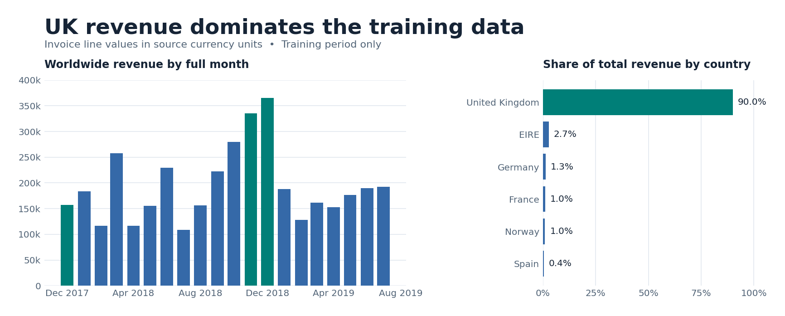
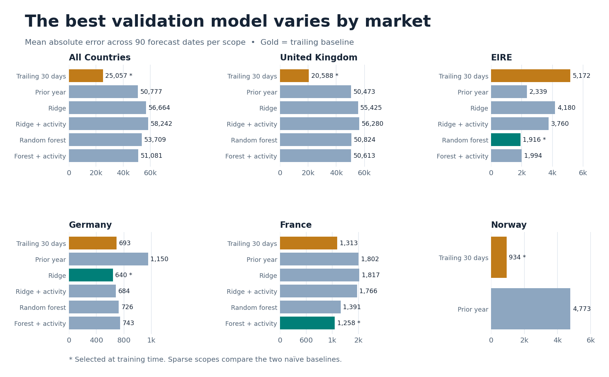
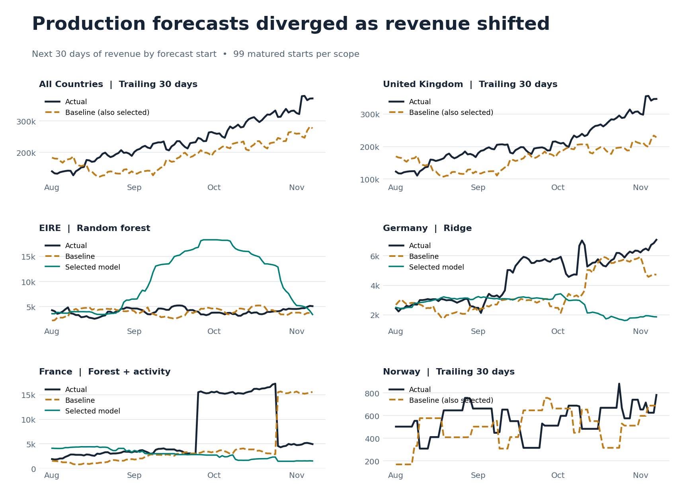

# Forecasting 30 days of revenue for AAVAIL

## Business question

AAVAIL’s leadership needs a 30-day revenue outlook for decisions made at month-end and mid-month, at both the country and company levels. The forecast measures the sum of recorded invoice line values from the requested date through 29 days later. Mean absolute error (MAE), in source currency units, captures how far the forecast typically misses the planning amount. Weighted absolute percentage error (WAPE) gives the size of the miss relative to observed revenue. Signed bias shows whether the forecast tends to overstate or understate revenue.

### Data requirements and hypotheses

The ideal input is a dated ledger of invoice lines with a consistent net amount, country, stable invoice and stream identifiers, and a traceable record of cancellations and currency conversion. Views and purchase activity let the model test whether demand signals add value. Published coverage dates help distinguish zero-sales days from late or missing files. Promotion calendars and market changes would help explain revenue shifts when activity history alone falls short.

- Recent revenue should be a strong baseline for predicting the next 30 days. Compare every candidate with the preceding 30-day total.
- Annual seasonality may improve forecasts. Compare the equivalent 30-day window one year earlier with the recent-revenue baseline.
- Views, line counts, and invoice counts may improve forecasts beyond revenue history and calendar features. Compare both Ridge and Random Forest with and without those activity features.

## Ingestion and exploration

The training corpus contains 815,011 invoice lines across 43 countries from November 28, 2017 through July 31, 2019. The ingestion function standardizes variant field names, strips non-digits for invoice matching, validates source files and dates, and creates one daily row per country and one worldwide row. It uses the original signed invoice values, retains repeated invoice lines, and counts distinct invoice and stream IDs within each scope. The source does not specify a currency conversion or a revenue recognition policy. The analysis reports recorded values in source units and preserves signed adjustments.

After checking the file dates, the pipeline filled days within the observed period that had no rows with zero. This includes 116 days with no worldwide transactions. A missing source export can resemble a run of quiet days, so operators should verify source completeness against the ledger before training or scoring.

- The UK accounts for 90.0% of training revenue. Worldwide and UK forecasts face similar exposure when UK revenue changes.
- Worldwide revenue reached about 335,171 in November and 365,052 in December 2018. The training set covers one complete late-year peak, so the annual seasonal estimate has limited evidence.
- Worldwide daily revenue had Spearman correlations of 0.89 with line count, 0.82 with views, and 0.80 with invoice count. The activity features use lagged values. These same-day correlations alone do not establish that activity improves a 30-day prediction.

## Model comparison and deployment choice

The candidates are trailing-30-day and prior-year naïve forecasts, scaled Ridge, and Random Forest. Both learned estimators were evaluated with and without trailing activity features. The design uses trailing revenue sums over 7, 14, 30, 60, and 90 days, an aligned prior-year sum, and annual calendar features. Sparse markets with fewer than 25 revenue-active days compare the two naïve methods.

Three expanding-window folds evaluated 30 daily starts each. The first starts were March 5, April 19, and June 3, 2019. Training labels for each fold ended before its first forecast start. Validation features used observations available as of each date. The candidate with lowest MAE was selected separately per scope and refit on all applicable training history. Across 44 scopes, the selected models were trailing baseline for 25, prior-year baseline for 11, Random Forest variants for five, and Ridge variants for three.

The trailing baseline had the lowest validation MAE worldwide and in the UK. EIRE selected Random Forest (1,916 MAE versus 5,172), Germany selected Ridge (640 versus 693), and France selected Random Forest with activity (1,258 versus 1,313). Adding activity helped the winning French model in validation. The revenue-only versions were the winners in EIRE and Germany.

## Historical production replay

The model was frozen at July 31, 2019. The running HTTP API received 774 requests across six scopes from August 1 to December 7, 2019. Of those forecasts, 594 had all 30 days of actuals by December 6. The other 180 were pending and excluded from the error metrics. The forecasts use overlapping 30-day windows, so the errors describe operational performance across daily starts and should not be treated as independent statistical observations.

| Scope | Selected model | Selected MAE | Baseline MAE | Selected WAPE | Mean signed error |
| --- | --- | ---: | ---: | ---: | ---: |
| Worldwide | Trailing 30 days | 60,503 | 60,503 | 25.2% | −51,959 |
| United Kingdom | Trailing 30 days | 54,974 | 54,974 | 26.1% | −46,096 |
| EIRE | Random Forest | 6,410 | 1,022 | 159.4% | +6,259 |
| Germany | Ridge | 1,962 | 1,207 | 43.1% | −1,836 |
| France | Random Forest + activity | 5,109 | 5,904 | 71.1% | −4,262 |
| Norway | Trailing 30 days | 209 | 209 | 36.9% | −70 |

Worldwide and UK forecasts trailed the increase in actual revenue. France improved MAE by 13.5% against the baseline but missed the level of the October jump. EIRE and Germany triggered the monitoring rule after their selected models lost to the baseline. The replay metrics preserve those validation-based choices for an honest holdout comparison. If these alerts occurred live, an operator could evaluate a return to the trailing baseline using newly matured windows.

The replay recorded zero HTTP errors. The accuracy monitor reports MAE, RMSE, WAPE, and bias by model version and scope. The service also records latency and status codes for operational monitoring.

## Verification

The complete 21-test suite passed both locally and against the assembled Linux x86-64 image filesystem as UID 10001. An HTTP smoke test against the image's Gunicorn command exercised health, UK and worldwide predictions, log retrieval, and real retraining. The workspace denied the Unix sockets required by the Docker daemon. The supplied image archive was checked for layer integrity and the service was exercised in Linux user, mount, and PID namespaces. The Docker CI workflow runs the corresponding build and smoke tests on a Docker host.

| Evidence | File |
| --- | --- |
| Validation predictions for every candidate and fold | [validation_predictions.csv](validation_predictions.csv) |
| Matched production predictions, baseline, and actuals | [scored_predictions.csv](scored_predictions.csv) |
| Accuracy, bias, and alerts by scope | [monitoring_metrics.json](monitoring_metrics.json) |
| HTTP request metrics | [replay_api_metrics.json](replay_api_metrics.json) |
| Image filesystem test output | [image_tests.txt](image_tests.txt) |
| Image filesystem HTTP smoke results | [image_http_smoke.json](image_http_smoke.json) |
